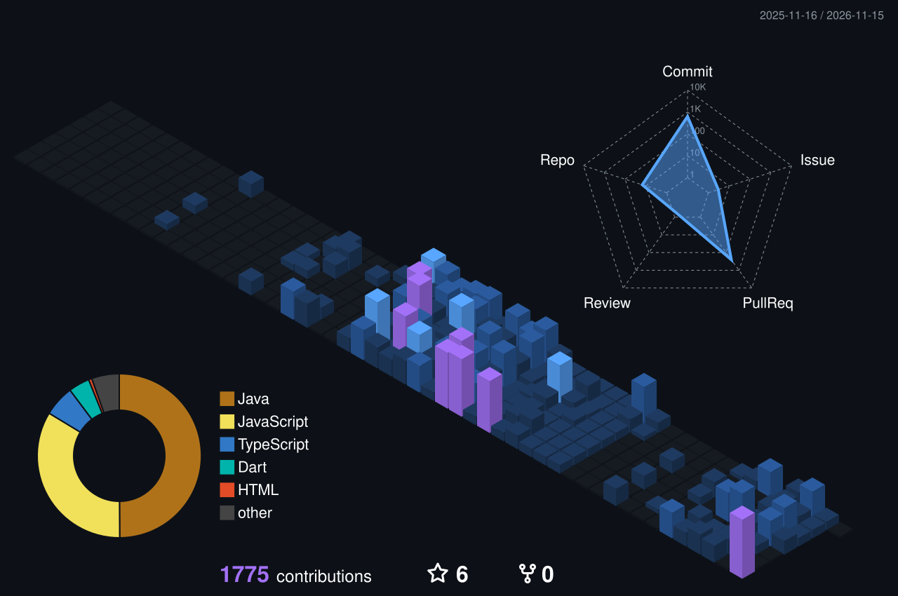

<h1 align="center">
  
</h1>

<h3 align="center">A passionate Final-Year Software Engineering Candidate from Sri Lanka 🇱🇰</h3>

  
  &nbsp;
  
  &nbsp;
  

---

  <i>"First, solve the problem. Then, write the code." - John Johnson</i>

---

### 👨‍💻 About Me

- 🎓 I am currently studying Software Engineering at the **Java Institute for Advanced Technology** and reading for my top-up degree from **Birmingham City University**.
- 🔭 I’m currently working on **Leafy Lane** (Organic food e-commerce) & **Smart City 360**.
- 🌱 I’m currently learning **Spring Boot**, **Flutter**, and **CI/CD DevOps Pipelines**.
- 💬 Ask me about **Java, Full Stack Development, and IoT**.
- 📫 How to reach me: **shangajanayake7@gmail.com**

---

### ⚡ My Tech Arsenal

  <strong>Frontend & Mobile:</strong>  
  

  <strong>Backend & Databases:</strong>  
  

  <strong>AI Tools (AI-Assisted Development):</strong>  
  &nbsp;&nbsp;&nbsp;
  &nbsp;&nbsp;&nbsp;
  &nbsp;&nbsp;&nbsp;
  &nbsp;&nbsp;&nbsp;
  &nbsp;&nbsp;&nbsp;
  

  <strong>DevOps, Tools & Others:</strong>  
  &nbsp;
  

---

### 📊 GitHub Activity & Stats

  

  
  

<h3 align="center">🧊 My 3D Contribution Graph</h3>

  

---

<h3 align="center">🐍 Contribution Snake</h3>

  

<h3 align="center">🤝 Connect with me</h3>

  &nbsp;&nbsp;&nbsp;&nbsp;&nbsp;
  &nbsp;&nbsp;&nbsp;&nbsp;&nbsp;
  &nbsp;&nbsp;&nbsp;&nbsp;&nbsp;
  

---

  <h3>Thank you for visiting my space!</h3>
  

    If you found my Full Stack or IoT projects helpful, I'd truly appreciate a 🌟 on my repositories. 
    Always excited to connect, collaborate, and build something amazing!
  

  
<b>Keep Building & Happy Coding! 🚀</b>

